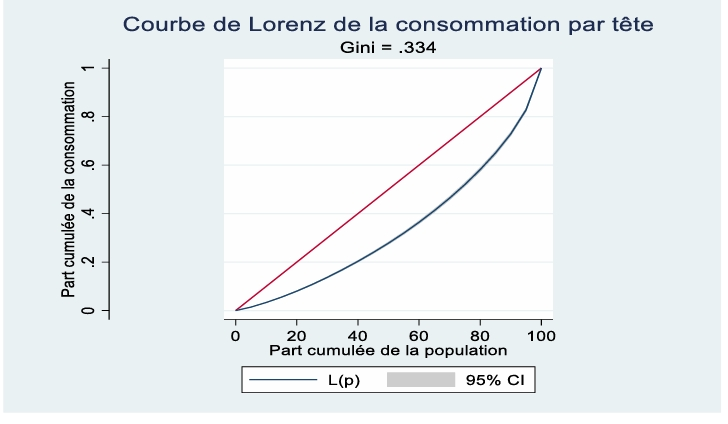

# Profil et facteurs associés à la pauvreté : cas du Sénégal

Projet de groupe, ENSEA (ISE 2), juin 2026. Logiciel : Stata.

## Contexte
Mesurer la pauvreté monétaire et ses inégalités au Sénégal en 2021 et identifier
les facteurs associés à la probabilité d'être pauvre.

## Données
EHCVM 2021/2022 (ANSD),Welfare, 7 120 ménages, téléchargée sur la plateforme de microdonnées
de la Banque Mondiale : l
-ien vers la page de l'enquête https://anads.ansd.sn/index.php/catalog/310).
*Les données brutes ne sont pas publiées ici (conditions d'utilisation).*

## Méthode
- Indices FGT (P0, P1, P2) avec intervalles de confiance à 95 % (plan de sondage complexe, `svy`)
- Inégalités : Gini, Theil, Atkinson, ratios de percentiles, courbe de Lorenz
- Désagrégation : milieu de résidence, région, genre et instruction du chef de ménage
- Modèle logit et effets marginaux moyens (`logit`, `margins`)

## Résultats principaux
- Pauvreté stable : P0 = 37,5 % [34,9 ; 40,1] en 2021 contre 37,8 % en 2018
- Rural 53,3 % contre urbain 20,0 % ; Kédougou : 65,7 %
- Gini = 0,334
- Effets marginaux (en points de pourcentage) : électricité −24,3 ; compte bancaire −7,0 ;
  éducation −5,7 par niveau ; agriculture +8,1 ; milieu rural +4,3
  -

## Contenu
- `dofile_projet2026.do` : fichier `.do` pour reproduire les résultats
- `figures/` : graphiques principaux

## Reproduire
Télécharger les données sur la plateforme de la Banque Mondiale, les placer dans `data/`,
adapter `global racine` en tête du `.do`, puis l'exécuter.

*Rapport complet disponible sur demande. / Full report available on request.*

## Mon rôle
Analyse économétrique : spécification et estimation du modèle logit, calcul des effets
marginaux moyens et interprétation des facteurs associés à la pauvreté
(réalisée en binôme avec Stéphanas Ahinon).

## Auteurs
-AHINON Stéphanas
-N'ZESSEU Madeleine
-N'GANTCHOU Arel
-TUO Fatima

## English summary
Poverty profile and associated factors in Senegal (EHCVM 2021, 7,120 households).
Poverty stagnated at 37.5% (vs 37.8% in 2018) and is concentrated in rural areas (53.3%).
A logit model shows that access to electricity, a bank account and the household
head's education are the factors most strongly associated with lower poverty.
Tools: Stata (FGT indices, inequality measures, logit, marginal effects).

